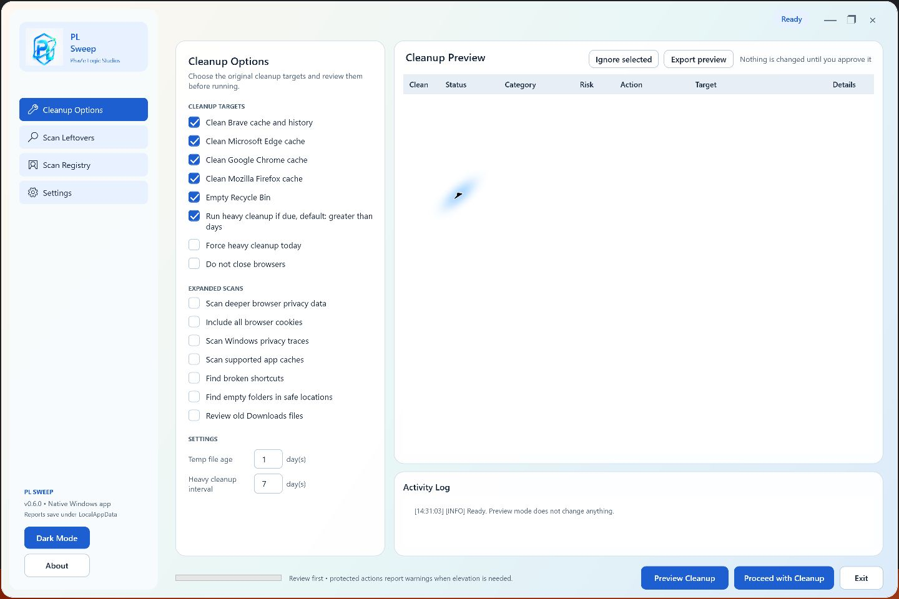
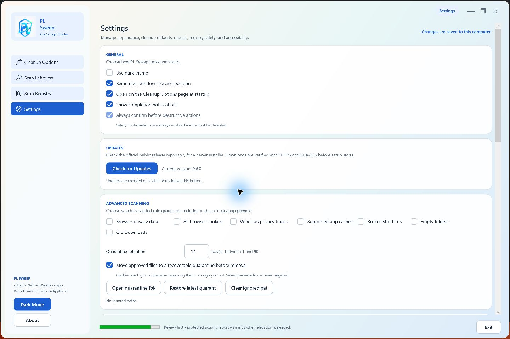
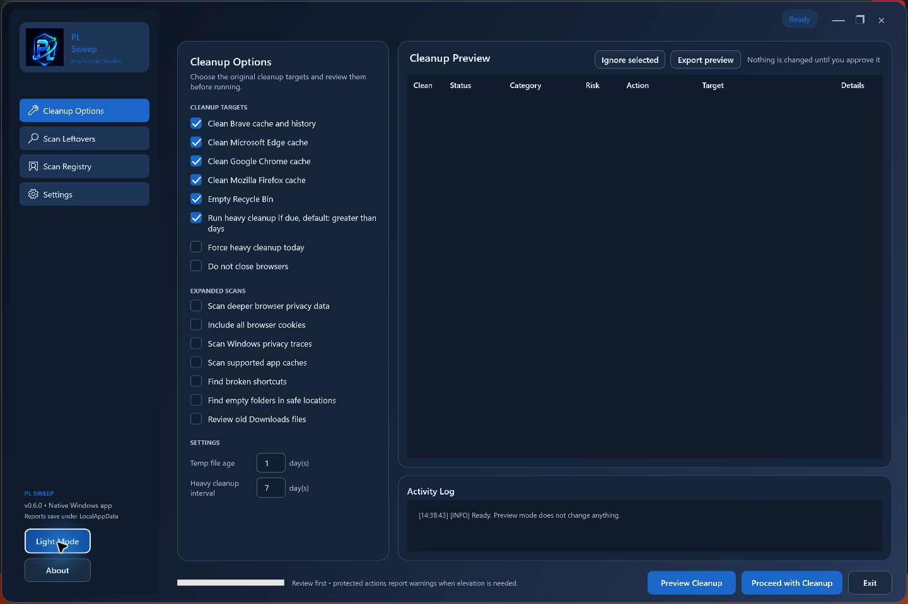

# Feature screenshots

These screenshots were captured from the local PL Sweep preview build on
October 11, 2026. The visible version is not a claim that an installer has been
published; check [Releases](https://github.com/phaze-logic/PLSweep-Releases/releases)
for actual availability. Only controls and empty results are shown: no personal
files, paths, scan results, or reports are included.

## Cleanup options and preview

Choose standard cleanup targets or optional expanded scans, set temporary-file
age and the maintenance interval, then generate a preview. The empty table below
shows the review workspace before any scan. Read [Usage](usage.md) for the
selection and confirmation process.

## Settings, updates, and quarantine

Settings provides appearance and startup controls, manual update checks, expanded
scan defaults, and quarantine retention/recovery controls. This image shows the
controls only; no quarantine contents or report folders are opened.
See [Installation and updates](installation.md) and [Recovery](usage.md#recovery-and-permanent-operations).

## Dark theme

The **Dark Mode / Light Mode** button switches the interface appearance. The
cleanup workspace keeps the same options and review flow in both themes.

## Updating screenshots

- Capture the actual app and record the build and capture date.
- Start a fresh session with an empty preview and Activity Log.
- Use controls-only screens. Never include personal files, absolute user paths,
  scan results, registry entries, browser data, reports, or quarantine contents.
- Do not run cleanup, purge folders, change the registry, restore backups, or
  open personal data to produce a screenshot.
- Inspect every image before saving it under `docs/assets/screenshots/`.
- Keep descriptive filenames and alt text; update links when replacing an image.
- Keep release availability separate from version labels visible in images.

[Documentation index](README.md) · [Product overview](../README.md)
